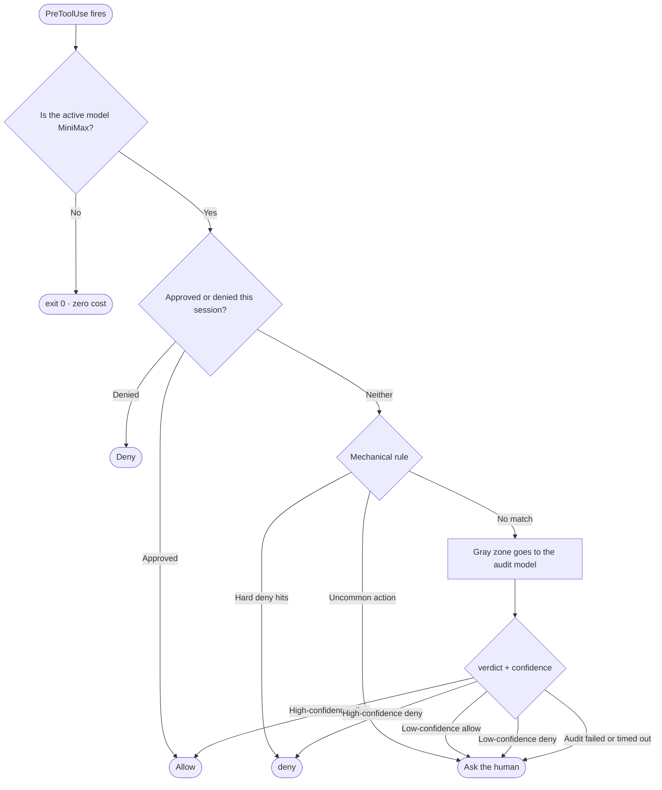

The delete came up again, aimed outside the project directory, because the model had decided a folder was temporary. I could approve it, deny it, or read the path carefully and hope I was reading the right one. All three put the decision in my attention, not in code.

I run several providers inside Claude Code, and MiniMax does this often enough that I stopped approving by eye: deleting outside the project, reaching for `~/.ssh`, touching the registry, pulling files from non-package-manager sources. So I built a cage around that model alone: hooks that recognise the active model in the transcript before they touch the tool call.

## Why a Claude Code hook instead of a wrapper?

A wrapper sits on the wrong side of the call: tool calls happen inside the session, not inside my wrapper.

Claude Code already gives me the right seat: PreToolUse fires before a tool runs, PostToolUse after it ran. Register there and the guard sees every call with its arguments, in order, for every model in the session. Wrap the model instead and you get a process and a config file per model.

## How do the three layers divide the work?

Each layer answers a different question, and the question decides the layer: mechanical, human, or judgment call.



### Layer one: mechanical rules for the inevitable

Some actions need no judgment, only a checklist: deleting or modifying anything outside the project directory, reading `~/.ssh` or `~/.aws`, writing to the registry. Those get a hard deny. No explanation, no negotiation, never waived, and intent never softens it. Paths are normalised first, then checked for containment; the pattern list is resident.

### Layer two: the human for the uncommon

Downloads are the interesting case. A file that didn't come from a package manager isn't automatically malicious, but it isn't something I want a model fetching on its own. The mechanical layer refuses to judge it and escalates it to a prompt: the user sees what was about to be downloaded and answers. The human stays in the loop only where the mechanical answer would be a guess.

### Layer three: the audit model for the gray zone

Some actions are neither forbidden nor rule-covered. "Write a config file into an unfamiliar path" is the classic one. Those go to a separate audit model, and the prompt hands over the environment facts: the legal toolchain root, the temp directory. The auditor answers with structured JSON:

```json
{"verdict": "deny", "confidence": 0.92, "severity": "high"}
```

### When the hook itself throws

It asks the human too. The most dangerous death for a safety mechanism is failing open, silently allowing a call it never saw. Every catch in the hook ends the same way: failed, ask a human.

## How do confidence routing and the session memo fight popup fatigue?

A popup isn't free: each spends the user's patience, the real budget of any safety mechanism. Ask twice about the same action and the second goes unread.

The first is confidence routing: the verdict carries a confidence value, and the routing table stays conservative.

- High-confidence allow → let it through
- Low-confidence allow → prompt the user
- High-confidence deny → refuse, with reason and confidence attached
- Low-confidence deny → prompt the user
- Audit timed out or unparseable → prompt the user

That last line is the floor: the fallback is always a human, never treat it as if nothing happened.

The second is the session memo. The same action shouldn't be asked twice, so `(tool, arguments, directory)` is normalised into one signature: approved ones go into `approved`, denied ones into `denied`, and the next identical call is answered from that list.

The PostToolUse half lets the memo learn on its own: if an action was prompted and then actually ran, the user approved it, and the hook records that signature into `approved` without asking again. One deliberate exception: a hard deny from the mechanical layer never enters the memo. There is no "I approved it once, so go ahead next time" when the path is `~/.ssh`.

## Why does the cage only lock MiniMax, and what does that cost?

Scope is the feature. Every hook checks the model first; if it isn't MiniMax it exits with `exit 0`: zero cost, zero popups. I use several models in one session, and a guard that fired on all of them would only train me to click through popups from the ones I trust.

The cost is honest: the guard is only as good as its idea of the model name in the transcript. Rename the model on the provider side and my check changes too. I'd rather have that failure than a guard I learn to ignore.

The auditor is still a model: a confident wrong deny wastes my time as badly as a confident wrong allow, so my thresholds stay conservative. The mechanical layer only knows paths, so a tool writing dangerous content inside the project slips past.

The repository is [LinuxLinking/claude-code-minimax-lockdown](https://github.com/LinuxLinking/claude-code-minimax-lockdown), MIT licensed, with a test case suite attached. What I haven't solved is how often that auditor is confidently wrong; I can't measure the rate.
