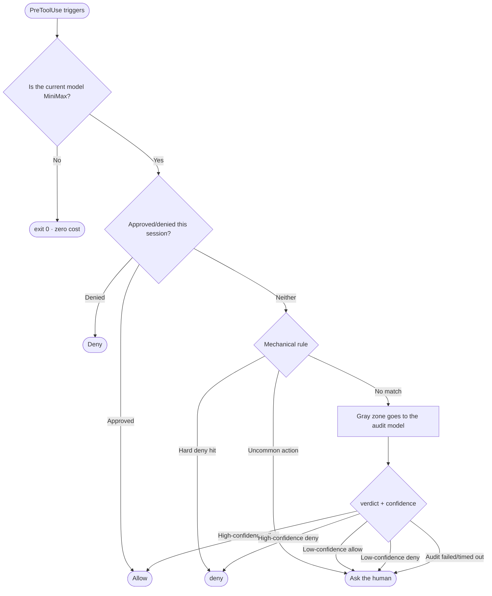

## The problem: why the cage locks exactly one model

I mix model providers inside Claude Code. Most of the time nothing happens, but one model (let it be MiniMax for now) keeps taking dangerous actions at high frequency: deleting things outside the project, trying to read `~/.ssh`, touching the registry, downloading files from unknown sources.

Other models don't need locking. So the project limits its scope from the name onward: **MiniMax Lockdown, a set of Claude Code hooks that only take effect while the current model is MiniMax.** Every time a hook fires, it first recognises the current model from the transcript; if it isn't MiniMax, it exits immediately with `exit 0` — zero cost, zero popups, and other models never know it happened.

The cage is custom-made for a repeat offender, not installed on behalf of the whole society.

## Three lines of defence



### Layer one: mechanical rules, for the inevitable

Some things need no judgement, only a checklist: deleting or modifying anything outside the project directory, reading `~/.ssh` and `~/.aws`, writing to the registry — **a hard deny, no explanation, no negotiation, never waived.** Paths are normalised first, then checked for containment; the pattern list is resident.

Other actions land in "uncommon but not necessarily bad": downloading a file that did not come from a package manager, for instance. The mechanical layer makes no judgement about those; it uniformly **escalates them to a human popup**. The principle of this layer is: decide outright what you can decide, and never pretend to be sure about what you cannot.

### Layer two: session memory, for popup fatigue

Every popup spends the user's patience, and patience is the real budget of any safety mechanism. So the same action should not be asked twice in one session: `(tool, arguments, directory)` is normalised into a single signature, approved actions go into `approved`, denied actions into `denied`.

The cleverer half is the PostToolUse side: any action that was previously popped up about and then **actually ran** proves the user approved it — the hook observes that fact after the fact and records the signature in `approved` on its own. The next identical action passes straight through, no question asked. The safety budget is spent on the first time, not on every time.

There is one deliberate exception: **a hard deny from the mechanical layer never enters the memory.** There is no "I approved it once, so go ahead next time" when it comes to reading `~/.ssh`.

### Layer three: the audit model, for the gray zone

Where mechanical rules cannot help — "write a config file into an unfamiliar path", say — the decision goes to a separate audit model. The prompt supplies the environment facts (the legal toolchain root, the temp directory) and demands structured JSON:

```json
{"verdict": "deny", "confidence": 0.92, "severity": "high"}
```

The real trick is the **confidence routing** that happens after the verdict arrives:

- High-confidence allow → let it through silently (don't bother the user)
- Low-confidence allow → popup (inclined to allow, but let a human check)
- High-confidence deny → refuse outright, with the reason and the confidence attached
- Low-confidence deny → popup
- **The audit model times out or returns unparseable output → popup, always**

That last line is the floor of the whole system: the fallback is always "hand it to a human", never "treat it as if nothing happened".

## A philosophy of failure

What if the hook itself throws? Popup, and ask the human. The most dangerous way for a safety mechanism to die is not refusing too much — it is **silently allowing things when it is broken**. Lockdown writes "failed → ask a human" into every single catch.

## Closing

The three layers each cover one stretch: **code handles the certain, humans handle the exceptions, a model handles the gray zone**; the session memory and the confidence routing are what keep the mechanism from driving the user insane. It is not elegant, but every layer maps to a real failure mode, and the whole thing can be uninstalled at any time — swap back a model you trust and the cage disappears on its own.

The repository is [LinuxLinking/claude-code-minimax-lockdown](https://github.com/LinuxLinking/claude-code-minimax-lockdown), MIT licensed, with a test case suite attached.
