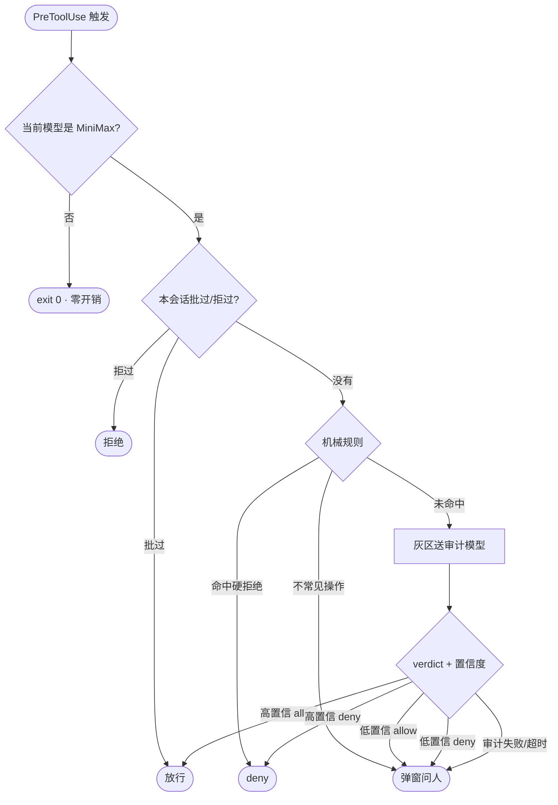

## 问题：笼子为什么只锁一个模型

我在 Claude Code 里混用多家模型。绝大多数时候相安无事，唯独某一个模型（姑息它一下，叫它 MiniMax）高频地做危险动作：跑到项目外删东西、试图读 `~/.ssh`、动注册表、下载来路不明的文件。

别的模型不用锁。所以这个项目从名字开始就限定了范围：**MiniMax Lockdown，一套 Claude Code hook，只在当前模型是 MiniMax 时生效。** 每次 hook 被触发，先从 transcript 里认出当前模型；不是它，立刻 `exit 0`——零开销，零弹窗，其他模型毫无感知。

笼子是给惯犯定制的，不是给全社会装的。

## 三层防线



### 第一层：机械规则，管「必然」

有些事不需要判断力，只需要清单：项目目录外的删改、读 `~/.ssh` 和 `~/.aws`、写注册表——**直接硬拒绝，不解释、不商量、永不豁免**。路径归一化之后做包含判断，模式清单常驻。

另一些动作落在「不常见但不必然坏」：比如下载一个非包管理器来源的文件。机械层对它们不做判断，统一**升级成人肉弹窗**——这一层的设计原则是：能确定的一票定案，确定不了的绝不假装能确定。

### 第二层：会话备忘，管「弹窗疲劳」

每次弹窗都在消耗用户的耐心，而耐心是安全机制真正的预算。所以同一操作在会话内不该问第二遍：`(工具, 参数, 目录)` 归一成一个签名，批过的进 `approved`，拒过的进 `denied`。

更巧的是 PostToolUse 那一半：凡是之前弹窗问过、后来**真的跑了**的操作，说明用户批过——hook 在事后观察到这个事实，主动把签名记进 `approved`。下次同样的操作直接放行，连问都不问。安全预算花在第一次，而不是每次。

有一个刻意的例外：**机械层的硬拒绝永不进备忘**。读 `~/.ssh` 没有「这次批了下次就随便读」的说法。

### 第三层：审计模型，管「灰区」

机械规则管不了的地方——比如「往一个陌生路径写配置文件」——送独立的审计模型裁决。prompt 里给定环境事实（合法工具链根目录、临时目录），要求输出结构化 JSON：

```json
{"verdict": "deny", "confidence": 0.92, "severity": "high"}
```

拿到裁决后的**置信度路由**才是精髓：

- 高置信 allow → 静默放行（别烦用户）
- 低置信 allow → 弹窗（倾向放行，但让人把关）
- 高置信 deny → 直接拒绝（附理由和置信度）
- 低置信 deny → 弹窗
- **审计模型超时、输出不可解析 → 一律弹窗**

最后一条是整个系统的底线：兜底动作永远是「交给人」，永远不是「当作没事」。

## 失败哲学

hook 自己抛异常怎么办？同样弹窗问人。一个安全机制最危险的死法不是拒绝得太狠，而是**故障时静默放行**。Lockdown 把「出错 → 问人」写进了每一个 catch。

## 收束

三层防线各管一段：**代码管必然，人管例外，模型管灰区**；备忘和置信度路由负责让这套机制不把用户烦死。它不优雅，但每一层都对应一种真实的失败模式，而且随时可以整体卸载——换回你信得过的模型，笼子自己就消失了。

仓库在 [LinuxLinking/claude-code-minimax-lockdown](https://github.com/LinuxLinking/claude-code-minimax-lockdown)，MIT 协议，附测试用例集。
