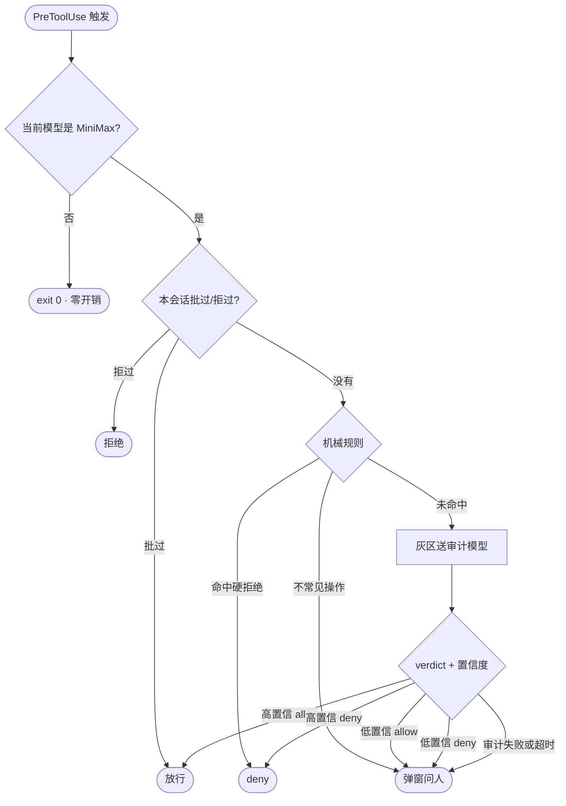

删文件的请求又冒出来了，目标在项目目录之外。我可以批，可以拒，也可以盯着路径看半天。三种做法都把判断留在注意力里，不在代码里。

我在 Claude Code 里混用几家模型，MiniMax 高频地做危险动作：删项目外的东西、读 `~/.ssh`、动注册表、从非包管理器源拉文件。我不想再靠眼睛确认，于是只给它造笼子：MiniMax Lockdown，一组先认出模型、再决定管不理的 hook。

## 为什么用 Claude Code hook 不用 wrapper

wrapper 站在错误的一侧：工具调用在会话内部。Claude Code 把位子留好了：PreToolUse 在工具执行前触发，PostToolUse 在执行后触发。在那儿注册，守卫能带着参数按顺序看到每次调用，换模型也不用重配；包住模型则是一个模型一个进程、一份配置。

## 三层防线各管哪一段

每层回答不同的问题：机械的、人的、还是判断。



### 第一层：机械规则，管必然

有些事不需要判断力，只要一张清单：项目目录外的删改、读 `~/.ssh` 和 `~/.aws`、写注册表。命中就硬拒绝，不解释、不商量、永不豁免。路径先归一化再做包含判断，模式清单常驻。

### 第二层：人，管不常见

不是包管理器来源的文件不一定恶意，可我不希望模型自己去拉。机械层不判断，直接升级成弹窗：用户看到要下什么，答一句。人只出现在机械答案只能靠猜时。

### 第三层：审计模型，管灰区

有些动作既不违规，也没被规则覆盖，比如「往陌生路径写配置文件」。这类交给独立审计模型，prompt 里给全环境事实：合法工具链根目录、临时目录。审计模型回结构化 JSON：

```json
{"verdict": "deny", "confidence": 0.92, "severity": "high"}
```

hook 自己抛异常也弹窗。安全机制最危险的死法是坏掉后悄悄放行。每个 catch 都收成一句：出错，问人。

## 弹窗疲劳怎么治

弹窗不免费：每弹一次都花用户的耐心，而耐心是安全机制的预算。

两件事在挡。第一件是置信度路由：verdict 自带 confidence，路由表保守：

- 高置信 allow → 静默放行
- 低置信 allow → 弹窗
- 高置信 deny → 直接拒绝，附理由
- 低置信 deny → 弹窗
- 审计超时或输出不可解析 → 弹窗

最后一条是底线：兜底永远交给人，不会当作没事。

第二件是会话备忘：同一操作不该问第二遍，于是把 `(工具, 参数, 目录)` 归一成一个签名，批过的进 `approved`，拒过的进 `denied`，下次直接查表。

PostToolUse 那一半让备忘自己会长：某个动作弹过窗、后来真跑了，说明用户批过，hook 事后看得见，把签名记进 `approved`。机械层的硬拒绝永不进备忘：读 `~/.ssh` 没有「这次批了下次就随便读」。

## 为什么只锁 MiniMax，代价是什么

范围本身就是功能：每次 hook 触发都先认模型，不是 MiniMax 就 `exit 0`，零开销零弹窗。混用几个模型时，对谁都触发的守卫只会训练我闭眼点同意。

代价也实在：守卫认模型，取决于 transcript 里模型名长什么样。供应商改了名字，我这边就得跟着改。我宁愿接受这种失败，好过一套对谁都弹窗、最后被我练成条件反射的守卫。

审计模型还是模型。它会错，还可能错得很自信：误拒和误放一样糟，所以阈值偏保守。机械层只认路径，项目目录里的危险内容它看不见。

仓库在 [LinuxLinking/claude-code-minimax-lockdown](https://github.com/LinuxLinking/claude-code-minimax-lockdown)，MIT 协议，附测试用例集。还没解决的是审计模型本身：它错得有多自信，我量不出来。
