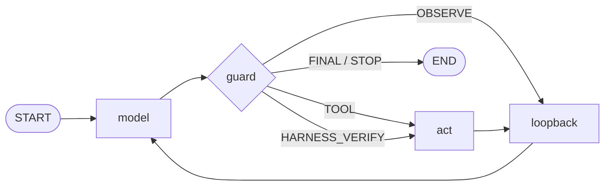

## A list of failure modes

qwen2.5-coder:3b can write a correct FizzBuzz and fix a broken indentation. But it will also:

- write a file, never run it once, and announce "created and verified, exit code 0, all good";
- keep calling tools after verification passed, not knowing that it is already finished;
- hammer the same `read_file` five times with byte-identical input;
- emit an empty string for an entire turn;
- get the Action Input JSON wrong — single quotes, triple quotes, trailing nonsense;
- hallucinate its own `Observation:` and keep making up results that were never executed.

None of these are hypothetical; they are the daily routine of a 3B model. So the project's stance was settled from the start: **the model only proposes; the harness disposes.** A prompt can guide it, but you cannot count on it.

## Overall structure: three nodes, one pipeline

The whole project is about 1200 lines running on LangGraph. The execution graph has a single spine:



The three nodes each have one job: `model` calls the model and parses its output; `guard` arbitrates — this step decides *what is allowed to happen*; `act` runs the tool and wraps the result into an Observation that is fed back in. The key is that the guard sits between model and act as a mandatory checkpoint: if the model wants a tool, the guard has to agree; if the model wants to wrap up, the guard has to accept; and if the model refuses to cooperate, the guard is entitled to make `act` ignore it.

### Why a text protocol and not function calling

Small models follow strict JSON tool calls badly, but they are excellent at mimicking three lines of plain text. So the agent speaks the classic ReAct text protocol (`Thought / Action / Action Input`), and the parser carries three levels of fallback: if `json.loads` fails it tries `raw_decode` first to ignore trailing nonsense, then `ast.literal_eval` to accept Python literal syntax, and if that also fails it tags the output `__PARSE_FAILED__` and hands it to the guard. A parse failure is not an exception — it is an ordinary state inside the flow.

The system prompt also spells out the workflow and the anti-loop rules. Writing the rules twice is not redundancy: the prompt is a **soft constraint**, meant to lure the model onto the right path; the guard is a **hard constraint**, meant to haul it back when it drifts. One layer is for the model to read, the other for the runtime to execute.

## First line of defence: paths, 18 lines of code

The tools are the only surface where side effects happen. All four of them — `read_file`, `write_file`, `list_dir`, `run_python` — go through the same entry point:

```python
def safe_path(rel: str) -> Path:
    abs_path = ... .resolve()          # expand ../ and symlinks
    try:
        abs_path.relative_to(SANDBOX_DIR.resolve())
    except ValueError:
        raise ValueError(f"path escapes the sandbox, only files inside are allowed: {rel}")
```

`resolve()` expands symlinks and `../`, `relative_to` tests containment, and anything outside is rejected outright — no allowlist, no exception branch. `run_python` adds three more rules on top: only `.py` files execute, the working directory is pinned to the sandbox, and there is a 30-second timeout.

On top of that, the exceptions of every tool are swallowed and turned into string Observations — the loop can never crash, and the error message itself becomes feedback fed back to the model.

## Second line of defence: behaviour arbitration, one pure function

The path guard decides *where you may touch*; the behaviour guard decides *what you are allowed to do*. The core is an arbitration function of roughly 170 lines in `guards/policy.py`:

```text
GuardView  ──>  evaluate_guards()  ──>  GuardOutcome
(input: this step's action + counters)   (output: verdict + counter deltas)
```

It arbitrates rule by rule in a fixed priority order, each rule matching one failure mode from the list above:

1. **Write then verify** — after a `write_file`, the next step must be `run_python`. The model wants to `read_file` the file back first? Feed it a reminder; if it sidesteps twice, the harness runs it on the model's behalf and feeds back the real exit code and output. Note this is not a retry — it is *running it for you*: if the model refuses to get on with it, it gets put on it.
2. **Stop after verifying** — after a `run_python` returns exit code 0, further tool calls are intercepted with "verification passed, please give the Final Answer". Another small-model disease: it fixed the thing without knowing that it had fixed it.
3. **Loop breaker** — consecutive identical (Action, Input) pairs start counting. First time: a vague warning, "please move on to the next step"; second time: a three-line template that can be copied verbatim; fourth time: a hard stop that ends the turn.
4. **Empty-output fallback** — an empty string does not get to be a Final Answer, otherwise one empty reply would silently end the whole task. Feed back "the output is empty, please wrap up".
5. **Parse-failure retry** — give it a chance to rewrite the format; three misses and the turn stops hard.
6. None of the above — run the tool normally.

### The ladder of intervention

Read the rules above as a sequence and they share one shape: **remind → give a template → run it for them → hard stop.** This is basically how you onboard a new hire: first a reminder; if the reminder does not work, hand them a model answer to copy; if that still fails, do it for them; and if they truly cannot, call it and wrap up. Every rung has a counter behind it, so no rung can loop forever.

Incidentally, hallucinated Observations have two gates: on the generation side `Observation:` is a stop sequence, and on the parsing side the output is truncated at the first `Observation:`. Observation results can only come from a real execution.

## Why the guards have to be pure functions

`GuardView` and `GuardOutcome` are frozen dataclasses; `evaluate_guards` makes no model calls, does no IO and touches no global state — you feed it a view, it hands back a verdict, and the counters come back as deltas that the graph node accumulates. It does not even touch prompts; the wording of the feedback is injected by the `nudges` module.

What that buys you shows up in `tests/test_guards.py`: a FakeLLM replays scripted outputs, and six cases cover every failure mode — "verification-first fallback", "loop-break escalation", "empty-output fallback", "verification enforcement", … no model download, no GPU, under a second to run. The test names are the design intent.

Guard logic is most afraid of "change one thing, break another". As a pure function it becomes ordinary code: you can adjust thresholds freely, and the scripted tests will tell you whether you broke something.

## Honest limits

The guards defend against elementary mistakes, not against malicious code. `run_python` executes inside the sandbox directory, but it can import any installed library and reach the network, and the guards do not care about that at all — the threat model here is "the foreseeable mistakes of a 3B model", not an adversarial attacker. Actually defending against an untrusted model is a different craft; my other project, Lockdown, is exactly that.

Equally worth admitting: guards do not raise the ceiling of what the model can do. They only seal the floor — no more infinite loops, no more false reports of completion. A problem a 3B model cannot solve will not become solvable just because guards are added.

## Closing

The design of the whole harness condenses into one sentence: **don't ask whether the model can be trusted to restrain itself — turn restraint into code.**

The repository is [LinuxLinking/local_ollama_harness](https://github.com/LinuxLinking/local_ollama_harness), MIT licensed: four tools, one guard, one scripted test suite. `uv run main.py` and it runs.
