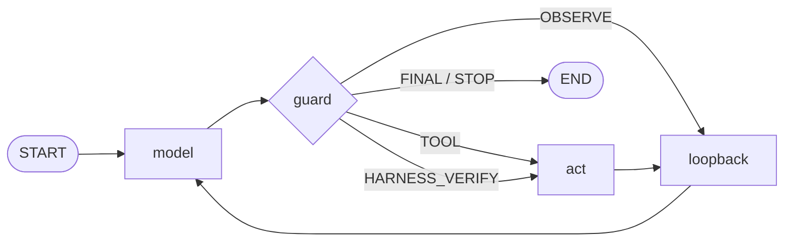

## 失败模式清单

qwen2.5-coder:3b 能写出正确的 FizzBuzz，也能修好缩进错误。但它同样会：

- 写完文件一次都没跑过，就宣布「已创建并验证，退出码 0，正常」；
- 验证通过之后继续调工具，不知道自己已经做完了；
- 在同一个 `read_file` 上连刷五遍一模一样的输入；
- 一整轮吐出空字符串；
- 把 Action Input 的 JSON 写错——单引号、三引号、尾部还带一句废话；
- 自己幻觉出 `Observation:`，然后对着不存在的执行结果继续编。

这些不是假设，是 3B 模型的高频日常。所以这个项目的设计立场从一开始就定了：**模型只负责提议，裁决权在 harness。** 提示词可以引导它，但不能指望它。

## 整体结构：三个节点，一条流水线

整个项目约 1200 行，跑在 LangGraph 上。执行图只有一条主干：



三个节点各司其职：`model` 调用模型并解析输出；`guard` 裁决——这一步*允许*发生什么；`act` 执行工具，把结果包成 Observation 回喂。关键在于 guard 卡在 model 和 act 之间，是必经关卡：模型说要用工具，得 guard 点头；模型说要收工，得 guard 认可；模型拒不配合，guard 有权让 act 无视它。

### 为什么是文本协议，不是 function calling

小模型对严格 JSON tool call 的遵循度很差，但对三行文本的模仿能力很强。所以 agent 走的是经典 ReAct 文本协议（`Thought / Action / Action Input`），解析层自带三级兜底：`json.loads` 失败先试 `raw_decode` 忽略尾部废话，再试 `ast.literal_eval` 兼容 Python 字面量写法，都不行就打上 `__PARSE_FAILED__` 标记交给守卫。解析失败不是异常，是流程内的一种常规状态。

系统提示词里也写了工作流和防循环规则。规则写两遍不是冗余：提示词是**软约束**，负责把模型往正路上引；守卫是**硬约束**，负责在它偏航时把它拽回来。一层给模型看，一层给运行时执行。

## 第一层守卫：路径，18 行代码

工具是唯一的副作用面。四个工具——`read_file`、`write_file`、`list_dir`、`run_python`——全部经过同一个入口：

```python
def safe_path(rel: str) -> Path:
    abs_path = ... .resolve()          # 展开 ../ 和符号链接
    try:
        abs_path.relative_to(SANDBOX_DIR.resolve())
    except ValueError:
        raise ValueError(f"路径越界，只能操作 sandbox 内文件: {rel}")
```

`resolve()` 展开符号链接和 `../`，`relative_to` 判定包含关系，越界直接拒绝——没有白名单，没有例外分支。`run_python` 在此之上再加三道：只执行 `.py`、工作目录固定在 sandbox、30 秒超时。

另外所有工具的异常都被统一吃掉、转成字符串 Observation——循环永不崩溃，错误信息本身就是回喂给模型的反馈。

## 第二层守卫：行为裁决，一个纯函数

路径守卫管「能碰哪里」，行为守卫管「允许做什么」。核心是 `guards/policy.py` 里一个约 170 行的裁决函数：

```text
GuardView  ──>  evaluate_guards()  ──>  GuardOutcome
(输入：本步动作 + 计数状态)      (输出：裁决 + 增量计数)
```

它按固定优先级逐条裁决，每条对应清单里的一种失败模式：

1. **写后必验**——`write_file` 之后，下一步必须是 `run_python`。模型想先 `read_file` 看一眼？回喂提醒；连续两次旁路，harness 直接代跑，把真实的退出码和输出回喂。注意不是重试，是**代跑**：模型拒不上路，就把它架上去。
2. **验证后收尾**——`run_python` 退出码 0 之后还继续调工具，拦截并提示「验证已通过，请给出 Final Answer」。小模型的另一个毛病是：修好了，但不知道自己修好了。
3. **防循环**——连续相同的 (Action, Input) 开始计数。第 1 次：泛泛警告「请推进到下一步」；第 2 次：换成可直接照抄的三行模板；第 4 次：强停，结束本回合。
4. **空输出兜底**——空字符串不配当 Final Answer，否则一次空回复就会静默终结整个任务。回喂「输出是空的，请收尾」。
5. **解析失败重试**——给机会重写格式，三次不中强停。
6. 以上都不命中——正常执行工具。

### 介入的阶梯

把上面的规则连起来看，会发现一个一致的形状：**提醒 → 给模板 → 代跑 → 强停**。这基本上是带新人的方式：先提醒；提醒没用，给一个能照抄的示范；还不行，上手替他做；实在做不了，喊停收工。每一级都有计数器兜底，任何一级都不会永远循环下去。

顺带一提，防模型幻觉 Observation 有两道闸：生成端把 `Observation:` 列入 stop sequence，解析端把输出截断在第一个 `Observation:` 之前。观测结果只能来自真实执行。

## 为什么守卫必须是纯函数

`GuardView` 和 `GuardOutcome` 都是 frozen dataclass；`evaluate_guards` 没有模型调用、没有 IO、没有全局状态——输入视图，输出裁决，计数器以增量返回、由图节点累加。它连提示词都不碰，回喂的话术通过 `nudges` 模块注入。

这换来的东西在 `tests/test_guards.py`：一个 FakeLLM 按预设剧本回放输出，六条用例覆盖全部失败模式——「验证前置兜底」「防循环二次升级」「空输出兜底」「验证强制」……不需要下载模型、不需要 GPU，跑完不到一秒。测试名就是设计意图。

守卫逻辑最怕「改一处崩一处」。变成纯函数之后，它就是普通代码：可以放心调阈值，剧本测试会告诉你有没有改坏。

## 诚实的边界

守卫防的是低级失误，不是恶意代码。`run_python` 跑在 sandbox 目录里，但 import 任意已安装的库、访问网络，守卫一概不管——这里的威胁模型是「3B 模型的可预见失误」，不是对抗性攻击。真要给不可信模型设防是另一门手艺，我的另一个项目 Lockdown 干的就是这事。

同样要承认：守卫不提升能力上限。它只是把下限封死——不再无限循环，不再假报完成。3B 解不出的题，加上守卫也解不出。

## 收束

整个 harness 的设计浓缩成一句话：**别问模型能不能靠自觉，把自觉变成代码。**

仓库在 [LinuxLinking/local_ollama_harness](https://github.com/LinuxLinking/local_ollama_harness)，MIT 协议，四个工具、一个守卫、一份剧本测试，`uv run main.py` 就能跑。
