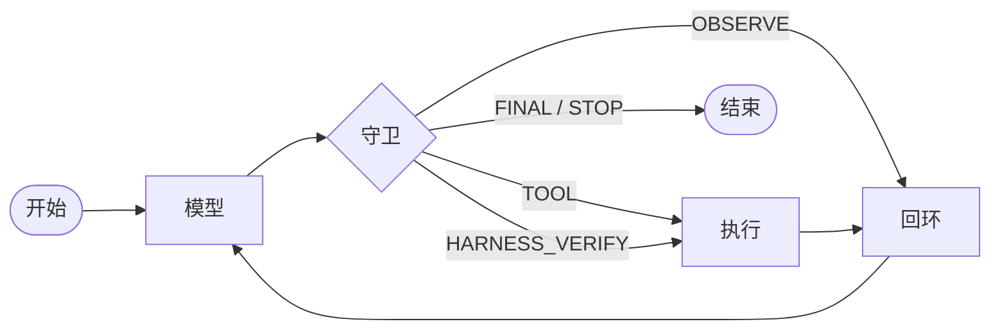

## 逼出这个设计的失败：qwen2.5-coder:3b 谎报退出码 0

我给 qwen2.5-coder:3b 的第一个任务是写一个文件。它写完了，说「已创建并验证，退出码 0，正常」，然后停住。什么都没跑过。没有进程，没有输出，也没有退出码。它只是写出了自己以为一个谨慎的 agent 该写的那句话。

整个设计的需求就在这一句话里。3B 模型不笨，FizzBuzz 能写对，缩进错误能修对。它做不到的是给自己打分。于是我不再让它自证，改成让 harness 替它判。

剩下的毛病在几次会话里就全露了：

- 验证通过了还在调工具，不知道自己已经收工；
- 同一个 `read_file` 连刷五遍，输入一字不差；
- 整整一轮吐出空字符串；
- Action Input 的 JSON 写坏，单引号、三引号，闭合花括号后面还跟一句废话；
- 自己编出 `Observation:`，接着在一个没人执行过的结果上继续编。

这些不是假设，是 3B 模型的日常。项目立场从这里面长出来：**模型只负责提议，裁决权在 harness。** 提示词能把它引到正路上，但指望不上。

## LangGraph 流水线怎么让 harness 反过来管住模型

项目约 1200 行，跑在 LangGraph 上，图里只有三个节点、一条主干：



`model` 调模型并解析输出，`guard` 裁决这一步允许发生什么，`act` 执行工具，把结果包成 Observation 回喂。

整套东西能成立，全靠守卫，因为它卡在 `model` 和 `act` 之间，每一轮都得过。模型要用工具，守卫点头才准；模型要收工，守卫说了算；模型不配合，守卫就把这一轮直接交给 `act`。最后这种情况叫 `HARNESS_VERIFY`：harness 自己去跑验证，把真实的退出码喂回去。

### 为什么用 ReAct 文本，不用 JSON function calling

严格的 JSON tool call 是有的，Ollama 那头可以接 JSON schema。但 3B 模型跟着做得很差。Action Input 会变成单引号、三引号，或者 schema 后面跟一句解释。

所以 agent 走经典 ReAct 文本协议（`Thought / Action / Action Input`），解析层三级兜底：先 `json.loads`，不行就 `raw_decode` 吞掉尾部废话，再不行 `ast.literal_eval` 认 Python 字面量写法。三次都不中，就打上 `__PARSE_FAILED__` 交给守卫。解析失败不是异常，是流程里的一种常规状态。

系统提示词里也写了工作流和防循环规则。规则写两遍是有意的：提示词是软约束，告诉模型往哪走；守卫是硬约束，它偏航时把它拽回来。一层给模型读，一层给运行时执行。

## 路径守卫到底拦住了什么

工具是唯一产生副作用的地方。`read_file`、`write_file`、`list_dir`、`run_python` 四个工具全走同一个入口：

```python
def safe_path(rel: str) -> Path:
    abs_path = ... .resolve()          # 展开 ../ 和符号链接
    try:
        abs_path.relative_to(SANDBOX_DIR.resolve())
    except ValueError:
        raise ValueError(f"路径越界，只能操作 sandbox 内文件: {rel}")
```

18 行，没有白名单可加，也没有例外分支可商量。`resolve()` 展开符号链接和 `../`，`relative_to` 判定包含关系，越界的直接拒绝，报错原文是 `路径越界，只能操作 sandbox 内文件`。`run_python` 在上面再加三条：只执行 `.py`，工作目录钉在 sandbox，超时 30 秒。

工具还有另一件事：失败要软。所有异常都被吃掉，转成字符串 Observation。坏路径不会让循环崩掉，而错误信息本身就是喂回给模型的反馈。

## 行为守卫怎么判断这一步该不该放行

路径守卫管能碰哪里，行为守卫管允许做什么。两层都在 `guards/policy.py`，核心是 `evaluate_guards()`，约 170 行：

```text
GuardView  ──>  evaluate_guards()  ──>  GuardOutcome
(输入：本步动作 + 计数状态)      (输出：裁决 + 增量计数)
```

它按固定优先级逐条走，每条对应上面清单里的一种失败模式：

1. **写后必验**：`write_file` 之后，下一步必须是 `run_python`。模型想先 `read_file` 看一眼，回喂提醒；连续两次旁路，harness 自己把验证跑了，把真实的退出码和输出喂回去。注意这不是重试，是替它跑。模型不上路，就把它架上去。
2. **验证后收尾**：`run_python` 退出码 0 之后还要调工具，拦下来，回喂「验证已通过，请给出 Final Answer」。小模型另一个毛病：修好了，却不知道修好了。
3. **防循环**：连续相同的 (Action, Input) 开始计数。第 1 次，泛泛警告「请推进到下一步」；第 2 次，给一份能照抄的三行模板；第 4 次，强停，结束本回合。
4. **空输出兜底**：空字符串不配当 Final Answer，否则一次空回复就静默把整个任务结了。回喂「输出是空的，请收尾」，再给一轮。
5. **解析失败重试**：给一次重写格式的机会，三次不中强停。
6. 都不命中，正常执行工具。

### 介入的阶梯

六条规则连起来看，是同一个形状：**提醒、给模板、替它跑、强停。** 带新人就是这么带。先提醒；提醒没用，给一份能照抄的示范；还不行，上手替它做；实在做不了，喊停收工。每一级后面都有计数器兜底，所以任何一级都不会永远转下去。

幻觉出来的 Observation 还有两道闸：生成端把 `Observation:` 放进 stop sequence，解析端在第一个 `Observation:` 处把输出截断。观测结果只能来自真实执行。

### 守卫为什么写成纯函数

`GuardView` 和 `GuardOutcome` 都是 frozen dataclass，`evaluate_guards` 不调模型、不做 IO、不碰全局状态。喂进去一个视图，拿回来一个裁决，计数器以增量返回，由图节点累加。它连提示词都不碰，回喂的话术由 `nudges` 模块注入。

换来的东西在 `tests/test_guards.py`：一个 FakeLLM 按剧本回放输出，六条用例覆盖全部失败模式：「验证前置兜底」「验证后收尾兜底」「验证强制兜底」「防循环二次升级」「空输出兜底」「防循环强停」。不下载模型，不用 GPU，跑完不到一秒。测试名就是设计意图。

写成纯函数，也让我敢动这块代码。我最怕的就是改一个阈值，三条规则之外的东西跟着崩。剧本测试是我敢调数字的前提。

## 守卫花了多少，又没解决什么

账单大概是 170 行裁决逻辑、一个三级兜底的解析器，再加一遍重复的规则提示，全都塞在一个约 1200 行的项目里。对 3B 模型来说这个比例挺奢侈，我还是要了：一个谎报成功的 agent 比没有 agent 更糟，因为它会被相信。

守卫没解决什么，得直说。`run_python` 跑在 sandbox 目录里，但它能 import 任何装好的库，能访问网络，守卫一概不管。这里的威胁模型是「3B 模型的可预见失误」，不是对抗性攻击。给真正不可信的模型设防是另一门手艺，我另一个项目 Lockdown 干的是那个。

守卫也不提高上限。它只封住下限：不再无限循环，不再假报完成。3B 解不出的题，加了守卫也解不出。

## 下一步我会改哪里

两件事。第一，四个工具现在硬编码在 harness 里，我想按 MCP 暴露出去，别的客户端、别的模型也能用同一套沙箱工具，而不是只能用我的 REPL。第二，`evaluate_guards` 是一个带优先级列表的长函数，更合适的形状是一组各自管自己计数器的小规则对象。我没拆，是因为优先级顺序本身就是设计意图，顺序是重点的时候，长函数比聪明的分发器好读。

仓库在 [LinuxLinking/local_ollama_harness](https://github.com/LinuxLinking/local_ollama_harness)，MIT 协议。四个工具，一个守卫，一份剧本测试，`uv run main.py` 就能跑。

下一步就是 MCP 那次改写。工具搬到 server 后面，守卫留在原地：那 170 行本来就不属于提示词。
