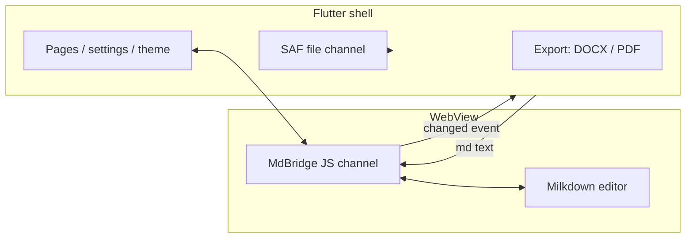

## Why hybrid

The first question when building a Markdown editor on Android is: what do you write the editing core in?

The all-Flutter option means implementing WYSIWYG rich-text editing yourself — caret positioning, selection and IME composition events alone would take a year. And in the Markdown editor space the web ecosystem already has far more mature answers, Milkdown among them: built on ProseMirror, WYSIWYG, with a complete plugin system.

So I went hybrid: **Flutter as the shell (files, settings, export, theme), Milkdown in a WebView (the editing surface)**, with a bridge between them. The price is two rendering systems and one boundary that has to be maintained with care. What you get in return is an editing core that is genuinely good to use.

## Decision one: only one protocol crosses the bridge

The easiest way for a WebView bridge to rot is to let message formats be improvised. Mdeditor pins down a single `MdBridge` channel whose messages are always JSON of the form `{type, ...}`: once initialisation is done the core replies `ready`, and every edit pushes a `changed` message carrying the full text.

The Flutter side receives with `addJavaScriptChannel('MdBridge', ...)` and sends with `evaluateJavascript`. The protocol is small enough to have only two message types, and that is exactly why it is stable — the complexity of a bridge is not in how much it can carry, but in whether both ends agree on when to say what.

## Decision two: the file stays where the user put it

The first thing many editors do when opening a file is **copy it into their own sandbox** and copy it back on save. That is an invisible migration for the user: after editing one file, a stray copy has appeared in phone storage.

Mdeditor goes through Android SAF: once the file is authorised, the Kotlin side calls `takePersistableUriPermission` on the URI, which makes that authorisation **persist across restarts**. Open, edit and save always target the original URI — the file never moves, only its contents change. The recent-files list stores URIs rather than copy paths, so "the one I edited in the Downloads folder yesterday" is still in the same place when you tap it today.

The price is that the SAF API is notoriously roundabout; every operation goes through an intent and column resolution. But that is the tax you pay for respecting where the user's files live.

## Decision three: write the DOCX yourself, don't drag in the whole family

When exporting DOCX, the convenient choice is to pull in a cross-platform document library. On Android those libraries are often tens of megabytes and they fight with Flutter's build system. Mdeditor's choice is to **write the OOXML by hand** — `document.xml`, the stylesheet, numbering, headers and footers, the table of contents, media relationships — generating each part and then zipping it up.

This is not showing off; it is control: code-block highlighting maps token by token, images are embedded through `media/` plus a relationship table, and the table-of-contents field refreshes itself when Word opens the file. The whole export runs on an isolate (`compute`), so the UI never stutters.

One trap along the way is worth recording: the markdown package escapes `<` and `&` into HTML entities by default, and DOCX's XML has to escape them again — two rounds of escaping stacked, the code in the body text came out as `&amp;lt;`. The fix is `encodeHtml: false` to switch off the first round and hand ownership of escaping entirely to the DOCX generator. **When two layers of escaping sit on one chain, you have to be explicit about which layer owns it.**

## Decision four: the theme is a one-way flow

The Flutter shell and the WebView each have their own styling system, and if the theme is not synchronised you get the split where "the shell is dark and the editing area is bright". Mdeditor packs the design tokens of the shell — colours, fonts, the code-highlight palette — into a `NativeEditorTheme` and pushes them one way into the WebView when the theme changes; on the Milkdown side they are mapped to CSS variables.

One-way means the editing area is always a consumer of the theme and can never push back on the shell. Two worlds, one bridge, one protocol, one direction — that is the floor for a hybrid architecture not to lose its mind.

## Closing

Hybrid is not shameful. What is shameful is mixing blood without a boundary: adding messages ad hoc, quietly copying files, dragging in dependencies. The four decisions of Mdeditor — a single bridge protocol, persisted SAF URIs, hand-rolled OOXML, one-way theming — are ultimately the same thing: **every time you accept someone else's technology, draw the boundary again.**

The repository is [LinuxLinking/Mdeditor](https://github.com/LinuxLinking/Mdeditor), GPL-3.0, with a README in Chinese, English, Japanese and French.
