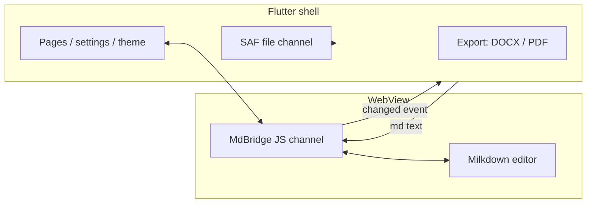

Every `<` inside a code block came out of the DOCX exporter as `&amp;lt;`. Two escaping layers on one value: the markdown package escaped `<` to `&lt;`, the DOCX XML writer escaped it again.

The fix was one option, `encodeHtml: false`: switch off the first round, leave escaping to the DOCX generator. Two layers on one chain, and now exactly one of them owns it.

## Why the hybrid editor puts Milkdown in a WebView

The question that decided the architecture: what language do I write the editing core in? The all-Flutter answer means implementing WYSIWYG rich-text editing myself, and caret positioning, selection and IME composition are each a project on their own. A year is a fair estimate for those three.

The web side already has an answer I would otherwise rebuild from scratch: Milkdown, built on ProseMirror, with remark under the parsing layer, WYSIWYG by default and a plugin system I did not design.

So I split the app in two. Flutter keeps files, settings, export and theme. Milkdown keeps the editing surface, in a WebView. In between sits one JavaScript channel.

The diagram is the whole architecture, and it is small on purpose. The price is two rendering systems and one boundary somebody has to hold in place.

## How much data crosses the bridge

A WebView bridge rots when each message invents its own format. Mdeditor pins down one channel, `MdBridge`, and every message on it is JSON shaped `{type, ...}`. There are exactly two types: after initialisation the core replies `ready`, and every edit pushes `changed` with the full text.

Flutter receives with `addJavaScriptChannel('MdBridge', ...)` and sends with `evaluateJavascript`.

> The complexity of a bridge isn't in how much it can carry, it's in whether both ends agree on when to say what.

The cost is that the shell never learns where the caret is. `changed` carries text, not a selection, so the native side holds a snapshot, not a cursor-aware buffer. Anything that needs the caret lives on the JavaScript side.

## Keeping SAF document URIs alive across restarts

Plenty of editors open a file by copying it into their own sandbox and copying it back on save. The user never sees that migration, but their storage ends up with a stray second copy.

Mdeditor goes through Android SAF. After the user picks a document, the Kotlin side calls `takePersistableUriPermission` on the URI, and that grant survives a reboot. Opening, editing and saving target the original URI, so the file never moves and only its contents change. The recent list stores URIs too, so yesterday's note is still where you left it today.

SAF is a roundabout API. Every operation goes through an intent and a column resolution. That's the tax for leaving the user's files where they are.

## Why not use a DOCX library

The lazy path to DOCX export is a cross-platform document library. On Android those run to tens of megabytes and fight with Flutter's build system.

So the OOXML is written by hand: `document.xml`, the stylesheet, numbering, headers and footers, the table of contents, media relationships. What that buys is control over the details: code-block highlighting maps token by token, images go in through `media/` plus a relationship table, and the table-of-contents field refreshes itself when Word opens the file. The export runs on an isolate (`compute`), so the UI doesn't stutter.

The `&amp;lt;` bug I opened with lives here. Two escaping layers, neither documented as owning the job, and the only way to find out which one is wrong is to export a file with a `<` in it and look.

## How the theme reaches the editor

The Flutter shell and the WebView have separate styling systems, so the shell packs its design tokens, colours, fonts and the code-highlight palette into a `NativeEditorTheme` and pushes them one way into the WebView when the theme changes. On the Milkdown side they become CSS variables.

One direction only: the editing area consumes the theme and never pushes back on the shell. A theme decision made inside the editor has to travel out to the shell and back; the editor can never be the source of truth.

## Where the hybrid hurts

Keyboard, selection and IME composition are ProseMirror's problem now, running inside a WebView I don't control. The caret work I avoided by going hybrid is still work; it moved somewhere I can't fix from Kotlin.

The full-text `changed` message is the other soft spot: every edit ships the whole document across the bridge, so the cost scales with file size. SAF's roundabouts and the two typography systems that drift apart are smaller, but they are what a user notices first: fonts get decided in two places, and nothing enforces that they agree. I haven't measured the `changed` overhead, and I'd rather say so than guess.

## What I would change

The protocol comes first. Two message types was right back when I didn't know what the editor would need from the shell. Now I'd add a third for commands that need a selection, and throttle `changed` so the shell stops receiving the whole document on every keystroke.

I wouldn't change the SAF decision, and I wouldn't trade the hand-written OOXML for a library. Both cost real time, and both buy what a library wouldn't: files that stay put, and an export I can change when Word complains.

What I wouldn't do again is this architecture for an app whose whole job is native text input. When the editor talks to the IME, the clipboard and the share sheet, the bridge stops being a seam and becomes the product. For a Markdown editor, where the core is the hard part and the rest is files and settings, it paid for itself.

The repository is [LinuxLinking/Mdeditor](https://github.com/LinuxLinking/Mdeditor), GPL-3.0, with a README in Chinese, English, Japanese and French. The next number I want is what the full-text `changed` message costs on a long document. I don't have it yet.
