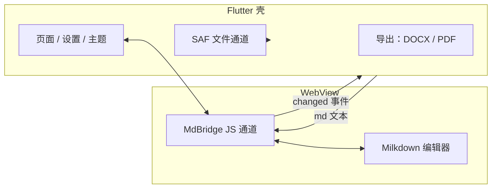

## 为什么是混血

Android 上做 Markdown 编辑器，第一道选择题就是：编辑器内核用什么写？

纯 Flutter 方案意味着自己实现所见即所得的富文本编辑——光光标定位、选区、输入法合成事件这三件事就够写一年。而 Markdown 编辑器这个赛道，web 生态里已经有成熟得多的答案，比如 Milkdown：基于 ProseMirror，所见即所得，插件体系完整。

所以我选了混血：**Flutter 做壳（文件、设置、导出、主题），WebView 里跑 Milkdown（编辑区）**，中间架一座桥。代价是两套渲染体系、一条必须精心维护的边界；换来的是一个真正好用的编辑内核。

## 决定一：桥上只走一种协议

WebView 桥最容易腐化的地方是消息格式随手写。Mdeditor 定死了一条 `MdBridge` 通道，消息永远是 `{type, ...}` 的 JSON：初始化完成后内核回 `ready`，用户每次编辑推 `changed` 并带上全文。

 Flutter 侧用 `addJavaScriptChannel('MdBridge', ...)` 收，用 `evaluateJavascript` 发。协议小到只剩两种消息，反而稳定——桥的复杂度不在于能传多少种东西，而在于两端对「什么时候说什么话」有没有共识。

## 决定二：文件停在用户放它的地方

很多编辑器打开文件的第一件事是**拷进自己的沙箱**，保存时再拷回去。这对用户是隐形的迁移：改完一个文件，手机存储里凭空多了一份副本。

Mdeditor 走 Android SAF：文件授权后，Kotlin 侧对 URI 调 `takePersistableUriPermission`，把这份授权**跨重启持久化**。打开、编辑、保存始终针对原始 URI——文件从来不动，动的只有内容。最近文件列表存的是 URI 而不是拷贝路径，所以「昨天在下载目录改的那篇」今天点开还在原地。

代价是 SAF 的 API 出了名的绕，每个操作都要过 intent 和列解析。但这是「尊重用户的文件在哪」该付的税。

## 决定三：DOCX 自己写，别拉全家桶

导出 DOCX 时，顺手的选择是拖一个跨平台文档库。但 Android 上这类库往往几十 MB、还和 Flutter 的构建体系打架。Mdeditor 的选择是：**直接手写 OOXML**——`document.xml`、样式表、编号、页眉页脚、目录、媒体关系，一份份生成再打包。

这不是炫技，是控制力：代码块高亮 token 级映射、图片嵌入走 `media/` + 关系表、目录字段由 Word 打开时自行刷新。整个导出跑在 isolate 里（`compute`），UI 不卡。

中间踩过一个值得记的坑：markdown 包默认会把 `<`、`&` 转义成 HTML 实体，而 DOCX 的 XML 还要再转义一次——两轮转义叠起来，正文里的代码就成了 `&amp;lt;`。解法是 `encodeHtml: false` 关掉第一轮，转义权完全收归 DOCX 生成器。**当一条链上有两层转义时，必须明确哪层拥有它。**

## 决定四：主题是一条单向流

Flutter 壳和 WebView 各有一套样式体系，主题不同步就会「壳是暗色、编辑区是亮色」的割裂。Mdeditor 把壳里的设计令牌（颜色、字体、代码高亮配色）打包成 `NativeEditorTheme`，切主题时单向推给 WebView，Milkdown 侧映射成 CSS 变量。

单向意味着编辑区永远是主题的消费者，不会反过来影响壳。两个世界只有一座桥、一种协议、一个方向——混血架构想要不精神分裂，这是底线。

## 收束

混血不丢人。丢人的是混了血却没有边界：桥上消息随手加、文件偷偷拷、依赖随手拖。Mdeditor 的四个决定——单一桥协议、SAF URI 持久化、手写 OOXML、主题单向流——说到底是同一件事：**每接受一次「别人的技术」，就把边界画清楚一次。**

仓库在 [LinuxLinking/Mdeditor](https://github.com/LinuxLinking/Mdeditor)，GPL-3.0，中英日法四语 README。
