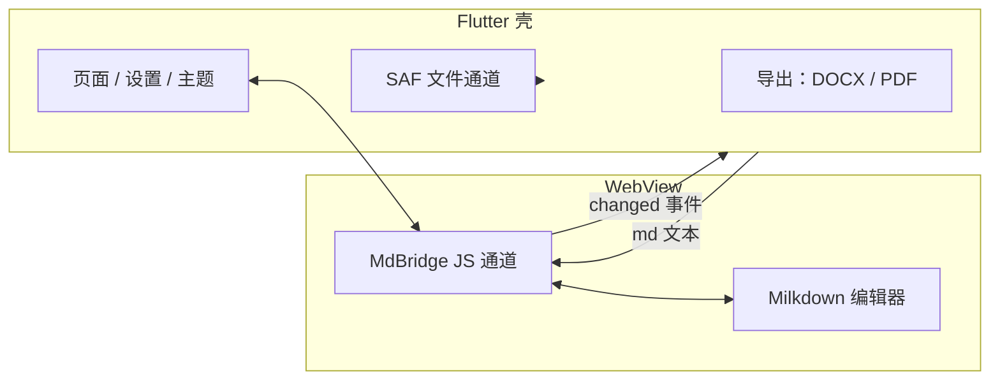

代码块里的 `<`，导出成 DOCX 后变成了 `&amp;lt;`。原因不复杂：转义套了两层。markdown 包先把 `<` 转成 `&lt;`，DOCX 的 XML 再转一次。

修法只有一个选项：`encodeHtml: false`，关掉第一轮，转义权交给 DOCX 生成器。一条链上两层转义，必须有一层说了算。

## 为什么混血编辑器要把 Milkdown 塞进 WebView

定架构要先回答：编辑内核用什么语言写。全 Flutter 意味着自己实现所见即所得的富文本编辑。光标定位、选区、输入法合成事件，每件都是独立工程，三件加起来一年不宽裕。

Markdown 编辑这件事，web 那边已有答案：Milkdown，基于 ProseMirror，解析层是 remark，所见即所得，插件现成。

所以 App 拆成两半。Flutter 拿文件、设置、导出、主题；Milkdown 拿编辑面，跑在 WebView 里，中间一条 JS 通道。

图就这么大，是故意的。代价是两套渲染体系，加一条得有人守着的边界。另一种活法是先花一年写内核。

## 桥上到底传了多少数据

WebView 的桥最容易烂在消息格式上。Mdeditor 钉死一条通道 `MdBridge`，消息永远是 `{type, ...}`。

消息只有两种：初始化完，内核回 `ready`，之后每次编辑推 `changed`，带全文。

Flutter 侧用 `addJavaScriptChannel('MdBridge', ...)` 收，用 `evaluateJavascript` 发。

> 桥的难处不在能传多少东西，而在两端对「什么时候说什么」有没有共识。

代价是壳永远不知道光标在哪。`changed` 带文本，不带选区，native 侧只有整篇快照，没有带光标的缓冲。想动光标只能在 JavaScript 那边做。

## SAF 的文档 URI 怎么跨重启活下来

不少编辑器打开文件先拷进沙箱，保存时再拷回去。用户看不见，手机存储里却多出一份副本。

Mdeditor 走 Android SAF。用户选完文档，Kotlin 侧对 URI 调 `takePersistableUriPermission`，授权能扛过重启。打开、编辑、保存都对着原始 URI，文件不挪窝，动的只有内容。最近列表存的也是 URI，昨天改过的那篇今天点开还在原地。

SAF 的 API 出了名的绕，每个操作都要过 intent 和列解析，报错是 Android 形状的，不是文件形状的。这是尊重用户文件位置的税。

## 导出 DOCX 为什么不直接用现成的库

导出 DOCX 最省事的做法是拖个跨平台文档库，Android 上这类库动辄几十 MB，还跟 Flutter 构建体系打架。

所以 OOXML 我自己写：`document.xml`、样式表、编号、页眉页脚、目录、媒体关系，生成再打包。换来的是控制：代码块高亮按 token 映射，图片走 `media/` 加关系表，目录字段等 Word 打开时自己刷新。导出跑在 isolate 里（`compute`），UI 不卡。

开头那个 `&amp;lt;` 就出在这一段。手写 OOXML 的代价长这样：两层转义没人认领，得导出一份带 `<` 的文件才看得出。

## 主题是怎么传进编辑区的

Flutter 壳和 WebView 各有一套样式。不同步就是壳暗、编辑区亮，像没做完。

壳把设计令牌打包成 `NativeEditorTheme`，颜色、字体、代码高亮配色都在里面，切主题时单向推进 WebView，Milkdown 侧映射成 CSS 变量。

> 只有一个方向。编辑区只消费主题，不反过来影响壳。

代价是编辑区里的主题决定必须绕到壳上再绕回来，它当不了源头。

## 这套混血架构在哪里难受

键盘、选区、输入法合成现在是 ProseMirror 的事，跑在我控制不了的 WebView 里。我用混血躲掉的光标活儿还在，只是换了个地方待着，在 Kotlin 这边修不了。

全文 `changed` 是另一个软肋。每次编辑都把整篇推过桥，开销跟着文件大小走，native 侧拿到的还是快照。这个开销我没量过。

SAF 的绕、两套字体的漂移都是小事，但用户先看见。字体在两处定，没人保证一样。

## 我会改哪些地方

先改协议。两种消息是我还不知道编辑器要什么时定的。现在知道了，加第三种消息给需要选区的命令用，再给 `changed` 限流，别让壳每次按键都收全文。

SAF 那个决定不改，手写 OOXML 也不改。两个都费真时间，换来的东西库给不了：文件待在原地，导出被 Word 挑刺时我改得动。

要是这 App 的主业是原生文本输入，我不会选这套架构。编辑区和输入法、剪贴板、分享面板不停对话时，桥就从接缝变成了产品。Markdown 编辑器的难处在编辑内核，别的只是文件和设置，这套扛得住。

仓库在 [LinuxLinking/Mdeditor](https://github.com/LinuxLinking/Mdeditor)，GPL-3.0，README 有中英日法四份。下一步想量的是全文 `changed` 在长文档上的开销。这个数字我还没有。
