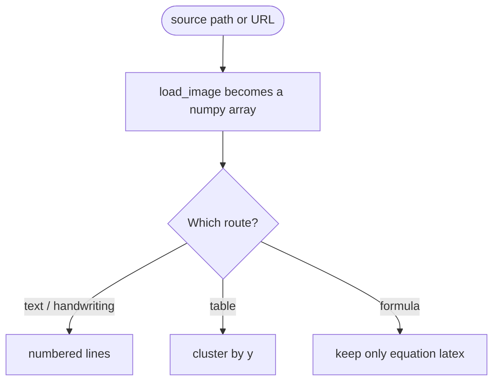

## The failure that set the design: OCR gives characters, not shapes

An agent that has to read a screenshot has two routes: hand the image to a model, or call an OCR service. The OCR route is cheap, flattens the layout out of the text, and turns formulas into unreadable strings.

On a spreadsheet screenshot it returned the header row, then the first data row, with no way to tell which column any number belonged to. The backend already knew: it had the bounding box of every text.

So the answer was not a more accurate OCR. It was four tools, one output shape each, one failure mode each.

## Four tools, four output shapes

`handle_list_tools` returns all four, and the parameters are nearly identical: `source` is required, `language` is optional and defaults to `ch` (README: `ch`, `en`, `japan`, `korean`), and only `ocr_recognize` carries `use_angle_cls`, default `true`. The difference is in the output:

- `ocr_recognize` returns numbered lines: `1. some text (置信度: 92.31%)`.
- `ocr_handwrite` returns the same shape.
- `ocr_table` returns an ASCII table, `+---+` separators, `|` between columns.
- `ocr_formula` returns numbered blocks: `公式 1:` and `  LaTeX: ...`.

Failures never travel as exceptions: `handle_call_tool` catches everything and returns one line of `OCR 处理失败: ...` with `is_error=True`.



## How the table parser recovers rows and columns

The table tool uses no dedicated table model. It reuses the text boxes the ordinary detection pass produced: `get_boxes` returns each box's text, its centre in x and y, and the confidence. `recognize_table` sorts the cells by (y, x), and `_cluster_rows` merges cells whose y differs by less than a threshold, half the average gap between neighbouring y values, or a fixed 20 for a single cell.

```python
y_diffs = [y_values[i+1] - y_values[i] for i in range(len(y_values)-1)]
avg_diff = sum(y_diffs) / len(y_diffs)
y_threshold = avg_diff * 0.5
```

Inside a row, cells are sorted by x, so a cell belongs to a column by its left-to-right order, not by the ruling lines. `format_table` draws the result.

The structure is real: the return value is `list[list[str]]`. But a column's identity is a guess. Merged cells, a missing cell, uneven row heights, and the columns shift; `format_table` pads by index, so the table looks aligned while it is not. That is `ocr_table`'s failure mode: **it guarantees a structure, not a correct one**.

## Why a formula comes back as LaTeX

The formula tool takes another route. `FormulaEngine` uses PaddleOCR's `PPStructure` with `table=True`, `ocr=True`, `layout=True` and `formula=True`. `layout=True` cuts the page into blocks first, and `formula=True` lets the engine recognise the formula blocks. After the call I keep only the items whose type is `'equation'` and take the `latex` field inside them. The LaTeX is not assembled by me; it is the model output, numbered and prefixed with `LaTeX:`.

If the layout analysis calls a formula text, the item never reaches this branch: anything whose type is not `'equation'` is dropped, and nothing says so.

## The input contract: a path and a URL take different routes

`source` accepts a local path or an http(s) address. `load_image` looks at the scheme with `urlparse`: `http` and `https` go down the URL branch, everything else down the path branch. A local path is resolved first, then checked three times: does the file exist, is it a file, is the extension on the whitelist. The image is read with `cv2.imdecode(np.fromfile(...))` instead of `cv2.imread`, to avoid problems with Chinese paths.

The URL branch uses `requests.get(url, timeout=30, stream=True)` and feeds the bytes to `cv2.imdecode`. **A remote image is never written to a temp file.** It is decoded in memory. The server fetches any address the caller hands it, with no size limit and no content-type check; I have not closed that.

## Lazy models and the install

The models load lazily: `OCREngine.__init__` leaves `self._ocr_instance` as `None` and the `from paddleocr import PaddleOCR` line sits inside `_init_ocr`, so the engine is built on the first real recognition. `FormulaEngine` does the same, and the Dockerfile says the same in a comment: startup downloads no models.

`create_ocr_engine()` builds a new `OCREngine()` on every call and throws it away, so nothing is reused across calls: the model files are cached, the engine object is not.

The install is ordinary Python packaging:

- PyPI package `ocr-mcp`, version `0.1.1`, console entry point `ocr-mcp = "ocr_mcp.server:main"`, transport stdio over `stdio_server()`.
- `server.json` is the MCP registry manifest named `io.github.LinuxLinking/ocr-mcp`; `smithery.yaml` holds a single line of config, `start: python -m ocr_mcp`.
- The Dockerfile starts from `python:3.10-slim`, installs `libgl1`, `libglib2.0-0` and `libgomp1`, and runs `pip install --no-cache-dir .`.

## What is still broken, and what I would change next

`ocr_handwrite` has no dedicated handwriting model. It calls the ordinary text recognition path with `use_angle_cls=True`, the same engine and the same models as `ocr_recognize`. The description says it recognises handwriting. That is a promise, not an implementation. The hard part of handwriting is detection, and once a stroke is missed the recognition cannot recover it.

Three smaller things:

- The versions disagree: `pyproject.toml` and `server.json` say `0.1.1`, `src/ocr_mcp/__init__.py` still says `__version__ = "0.1.0"`.
- The README tells you to run `pytest tests/ -v`, and there is no tests directory in the repository. The clustering threshold in `_cluster_rows` and the width arithmetic in `format_table` deserve tests first.
- Nothing calls `is_url`, `is_valid_image_path` or `get_image_info` in `utils.py`; `load_image` writes the same logic again inline.

Two things first: give `ocr_handwrite` a real handwriting model, or change the description to tell the truth; then write the tests before touching a threshold.

The repository is [LinuxLinking/ocr-mcp](https://github.com/LinuxLinking/ocr-mcp), MIT licensed. `pip install ocr-mcp`, run `ocr-mcp`, and it plugs into Claude Desktop.
