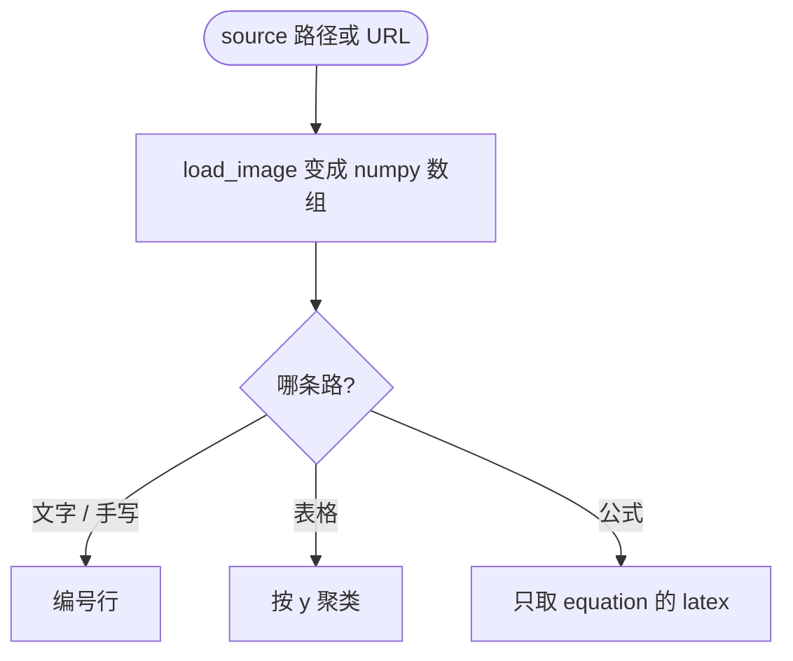

## 逼出这个设计的失败：OCR 只给字，不给形状

agent 要读一张截图，路只有两条：把图塞给模型，或者调 OCR。塞给模型贵；OCR 便宜，可吐出来的是一坨按检测顺序排的文本，行列关系没了，公式变成读不出来的符号。

我拿一张报表截图试过：回来的是表头「季度 收入 成本」，然后是「Q1 120 80」，看不出哪一列是哪一列。而 OCR 后端检测时已经拿到了每个文字框的位置。

结论不是「把 OCR 做得更准」，是「把形状分开」：四件工具，各自一种返回形状，也各自一种失败方式。

## 四件工具，四种返回形状

`handle_list_tools` 一次列全四件工具。参数几乎一样：`source` 必填，`language` 可选、默认 `ch`（README 列了 `ch`、`en`、`japan`、`korean`），只有 `ocr_recognize` 额外有 `use_angle_cls`，默认 `true`。差别全在返回：

- `ocr_recognize`：编号行，每行「序号. 文本 (置信度: 92.31%)」。
- `ocr_handwrite`：同一种形状。
- `ocr_table`：ASCII 表格，`+---+` 分隔线，`|` 分列。
- `ocr_formula`：编号块，每块「公式 1:」和「  LaTeX: ...」。

失败不走异常：`handle_call_tool` 把异常收成一行 `OCR 处理失败: ...`，配 `is_error=True` 回去。



四件工具拿到的都是同一个 numpy 数组，分叉在后面：文字和手写共用一条引擎路径，表格和公式各走各的。

## 表格的行列是怎么找回来的

表格工具没用现成的表格模型，它复用普通 OCR 检测到的文字框位置。`get_boxes` 为每个框返回文本、框中心的 x、y 和置信度；`recognize_table` 按 (y, x) 排序；`_cluster_rows` 把 y 差小于阈值的格子并成一行，阈值是相邻 y 差的平均值的一半，只有一个格子时固定 20：

```python
y_diffs = [y_values[i+1] - y_values[i] for i in range(len(y_values)-1)]
avg_diff = sum(y_diffs) / len(y_diffs)
y_threshold = avg_diff * 0.5
```

行内再按 x 排序，「哪一格属于哪一列」靠的是从左到右的先后，不是表格线。`format_table` 把二维列表画成 ASCII 表，中文按两个宽度算，列宽取各行最大值。

结构是真的：返回 `list[list[str]]`，行列关系留着。但列的身份是猜的。合并单元格、缺一格、行高不齐，列就会错位，而 `format_table` 按下标补空格，表格看着齐，实际歪。这就是 `ocr_table` 的失败方式：**它保证有结构，不保证结构对**。

## 公式为什么能直接给 LaTeX

公式工具走另一条路。`FormulaEngine` 用 PaddleOCR 的 `PPStructure`，四个开关全开：

```python
self._engine = PPStructure(
    table=True,
    ocr=True,
    layout=True,
    formula=True,
)
```

`layout=True` 先把版面切成块，`formula=True` 让引擎自己认公式块。识别完我只留 `type == 'equation'` 的块，取它 `res` 里的 `latex`。LaTeX 不是我拼的，是模型给的原文，返回时编号并标上 `LaTeX:`。

失败方式也清楚：公式块被版面分析判成 text，就进不了这个分支——`type` 不是 `'equation'` 就被丢掉，没有告警。识别得对不对是上游模型的本事。

## 输入、模型和安装

`source` 收本地路径或者 http(s) 地址。`load_image` 用 `urlparse` 看 scheme，`http` 和 `https` 走 URL 分支，其余走路径分支。本地路径先 `resolve()`，再查三件事：文件在不在、是不是文件、后缀在不在白名单里（`.jpg` `.jpeg` `.png` `.bmp` `.tiff` `.tif` `.webp`）。读完用 `cv2.imdecode(np.fromfile(...))` 而不是 `cv2.imread`，注释写的是避免中文路径问题。

URL 分支用 `requests.get(url, timeout=30, stream=True)`，字节直接进 `cv2.imdecode`。**远程图片不落盘**，全程在内存里解码。另一面也得说：这个服务会替调用方请求它给的任何地址，响应体整个读进内存，没有大小上限，也不校验 content-type。这个口子我知道，还没堵。

模型是懒加载的：`OCREngine.__init__` 里 `self._ocr_instance` 是 `None`，`from paddleocr import PaddleOCR` 写在 `_init_ocr` 内部，第一次真识别时才构造引擎，`FormulaEngine` 一样。所以服务起来不下载模型，第一次调用才下载。下载到哪里由 `_setup_cache_dirs` 决定：它在 `import cv2` 之前把 PADDLE_PDX_CACHE_HOME、PADDLE_HOME、PP_HOME、PADDLE_MODEL_HOME、HF_HOME 等七个缓存变量全指到项目下的 `.paddle_cache`，且只在用户没设过同名变量时才设。

还有一个容易忽略的后果：`create_ocr_engine()` 每次调用都新建一个 `OCREngine()`，用完就扔，「懒加载」只在单次调用内成立，跨调用不复用引擎对象。模型文件是缓存的，引擎实例不是。

安装是普通 Python 包的事：

- PyPI 包名 `ocr-mcp`，版本 `0.1.1`，控制台入口 `ocr-mcp = "ocr_mcp.server:main"`，传输是 stdio（`Server("ocr-mcp", ...)` 配 `stdio_server()`）。
- `server.json` 是 MCP 注册表清单，名字 `io.github.LinuxLinking/ocr-mcp`；`smithery.yaml` 的配置只有一行 `start: python -m ocr_mcp`。
- Dockerfile 底子是 `python:3.10-slim`，装 `libgl1`、`libglib2.0-0`、`libgomp1` 三个系统库，入口 `python -m ocr_mcp`。挂进 Claude Desktop 就是在 `mcpServers` 里加一条 command 为 `ocr-mcp` 的配置。

## 还没解决的，和下一步我会改哪里

先说一个我不想掩饰的地方：`ocr_handwrite` 没有专用手写模型。它调的就是普通文字识别那条路，`use_angle_cls=True`，跟 `ocr_recognize` 同一个引擎、同一套模型。工具说明里写着「识别图片中的手写文字内容」，那是承诺，不是实现。手写真正难的地方在文字检测，检测漏了后面的识别再好也救不回来，而这条路上没有单独的检测模型。

其他几处：

- 版本号对不上：`pyproject.toml` 和 `server.json` 都写 `0.1.1`，`src/ocr_mcp/__init__.py` 里还是 `__version__ = "0.1.0"`。
- README 让你跑 `pytest tests/ -v`，可仓库里没有 tests 目录。最该先有测试的是 `_cluster_rows` 的聚类阈值和 `format_table` 的宽度计算，两处都是纯函数。

下一步我先做两件事：给 `ocr_handwrite` 换上真的手写模型，或者把工具说明改成实话；再给 `_cluster_rows` 和 `format_table` 补上测试，然后才动阈值。现在改阈值只能拿真图去试。

仓库在 [LinuxLinking/ocr-mcp](https://github.com/LinuxLinking/ocr-mcp)，MIT 协议。`pip install ocr-mcp` 之后跑 `ocr-mcp`，就能挂在 Claude Desktop 上。
