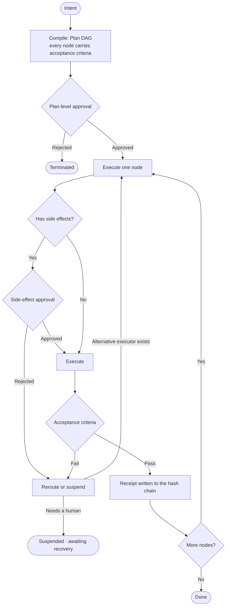

## The four ways agents die

Run enough agents on enough real tasks and you keep seeing the same four endings:

1. **Intent is a single prompt.** What the model will actually do, you only know once it has done it.
2. **Side effects depend on the model's mood.** Whether a file gets deleted or a request gets sent depends on the model's "judgement" this turn.
3. **The result lives in the chat log.** What was done and whether it worked can only be pieced together by scrolling through the conversation.
4. **One failed step stalls the whole chain.** When something in the middle crashes, the run either waits stupidly or starts over from scratch.

The eightieth agent framework on the market does not solve these, because they all spin inside the same layer — smarter scheduling, finer prompts, more tools. But all of that is about making the model "more reliable", and the common feature of the four deaths above is: **they cannot be solved by counting on the model to be reliable.**

## A position

Intent OS is not an agent, and not yet another framework. It sits above the agent:

> The model decides **how** to do it; this layer guarantees **that it was done right, that it can be traced, and that it can be rolled back**.

The agent is replaceable scaffolding; this layer is the product. Swap the agent underneath and intent compilation, acceptance verification, approval scheduling, the audit hash chain and elastic rerouting all stay the same.

## The life of a single run

Lay a run out flat and it looks like this:



Here it is segment by segment.

### Intent compilation: the Plan DAG

An intent arrives and is first compiled into a structured plan: nodes, dependencies, parameters, and — most importantly — **the acceptance criteria each action carries with it**. Acceptance is not "the model thinks it is right" but a machine-decidable predicate:

- `exit_code` — the target script exited with code 0
- `file_exists` — the artefact file exists
- `file_contains` — the artefact's contents contain a marker

Every acceptance result carries **evidence** rather than a dry boolean. When it fails you can see which criterion failed and on what evidence.

### Approval gates: two levels

Side effects cannot be decided by the model alone. So there are two gates:

- **Plan level** — the whole plan is shown first: what will be touched, how broad the scope is, whether it is reversible.
- **Side-effect level** — once the plan is approved, every node with side effects is confirmed again before it runs: which tool, what parameters, what the blast radius is, whether it can be undone.

Honesty here: in the current version the gates are CLI question-and-answer. A rules engine ("writes inside the sandbox are auto-approved, anything outside always asks a human") comes in the next stage. Putting the gate in the right *place* matters more than putting an automatic toll booth on it.

### Audit: the hash chain

Every approval, execution and acceptance writes a receipt. Each record carries `prev_hash` and `hash`:

```text
hash = SHA256(prev_hash + canonical payload)        # no key
hash = HMAC-SHA256(key, prev_hash + payload)         # with a key (root-only)
```

`prev_hash` links back to the previous record, so **tampering with any single record makes every hash after it stop matching**. The log can be verified and replayed, and a finished run can be sealed. When someone later asks "what exactly did it do that day", what you produce is not a chat transcript but a chain that is mathematically non-repudiable.

### Rerouting and suspension

A failed acceptance is not the end of the world. The rerouting engine picks an alternative executor by severity, and records which ones have been used and which are blacklisted; with no alternative left, or with too much residual risk, it **suspends** — sealing the scene into a task file, handing it to a human for a decision, and resuming from that file once the decision comes back. A single-point failure no longer stalls the whole chain.

## How it relates to my previous article

The protagonist of my previous essay, "Distrust the Model, Encode the Guard", is PyPilot — and in this system it is **just a replaceable L2 executor**. The runtime does not care who is doing the work underneath: a local small model, a large cloud model, an MCP toolchain, they are all "something that can execute a node" as far as it is concerned. The guards police the discipline of a single step; the runtime polices the trustworthiness of the whole chain.

## Honest limits

The first line of the repository README says it plainly: **prototype / research implementation, the public API will change.** What works today is the trunk line "intent → plan → approval → execution → acceptance → receipt"; the rules engine, multi-tenancy and concurrent scheduling are all still to come. I publish it because the answer to "where do the gates go" is worth discussing before the gates themselves are.

## Closing

Agent frameworks answer "how do we make the model smarter"; Intent OS answers "how do we make the model's actions verifiable". The first is a lever on model capability, the second is the foundation of engineering trust.

The repository is [LinuxLinking/Local_Agent_IntentOS](https://github.com/LinuxLinking/Local_Agent_IntentOS), MIT licensed.
