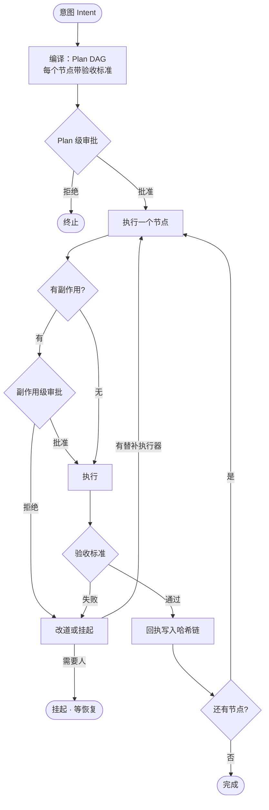

## Agent 的四种死法

先用足够多的 agent 跑足够真实的任务，你会反复看到同四种结局：

1. **意图是一句 prompt**。模型会执行什么，只有等它执行完你才知道。
2. **副作用凭模型心情**。删不删文件、发不发请求，取决于模型这一轮的"判断"。
3. **结果活在聊天记录里**。做过什么、做成了没有，翻聊天记录才能拼出来。
4. **一步失败，全链卡死**。中间某步崩了，整个 run 要么傻等，要么从头再来。

市面上第八十个 agent 框架解决不了这些问题，因为它们都在同一层里打转——调度更聪明、提示词更精细、工具更多。但这些都是让模型「更靠谱」，而上面四种死法的共同点是：**它们不能指望模型靠谱来解决。**

## 一个立场

Intent OS 不是 agent，也不是又一个框架。它坐在 agent 上面：

> 模型负责决定**怎么做**；这层负责保证**做对了、可追踪、错了能回滚**。

agent 是可替换的脚手架，这一层才是产品。底下换什么 agent，意图编译、验收验证、审批调度、审计哈希链、弹性改道，全都不变。

## 一次运行的一生

把一次 run 摊开，它长这样：



下面逐段拆。

### 意图编译：Plan DAG

意图进来先被编译成结构化的 Plan：节点、依赖、参数，以及最重要的——**每个动作自带的验收标准**。验收不是「模型觉得对了」，而是机器可判定的谓词：

- `exit_code` —— 目标脚本退出码为 0
- `file_exists` —— 产物文件存在
- `file_contains` —— 产物内容包含特征

每条验收的结果都带 **evidence**（证据），而不是一个干巴巴的布尔值。失败时你能看到是哪条标准、以什么证据失败的。

### 审批闸门：两级

副作用不能由模型单方面决定。所以有两道闸：

- **Plan 级**——整份计划先过目：要动哪些东西、范围多大、可不可逆。
- **副作用级**——计划批过了，每个带副作用的节点执行前还要再确认一次：哪个工具、什么参数、影响范围、可逆性。

这里要诚实：当前版本的闸门是 CLI 问答，规则引擎（比如「sandbox 内写文件自动放行，范围外一律问人」）在下一阶段。先把关卡的**位置**立对，比先给关卡装自动闸机重要。

### 审计：哈希链

每次审批、执行、验收都落一条回执。每条记录带 `prev_hash` 和 `hash`：

```text
hash = SHA256(prev_hash + 规范化 payload)        # 无密钥
hash = HMAC-SHA256(key, prev_hash + payload)     # 有密钥（root-only）
```

`prev_hash` 串起前一条，于是**篡改任意一条记录，其后所有哈希全部对不上**。日志可以验证、可以重放，跑完可以封存（seal）。事后有人问「那天它到底干了什么」，你拿出来的不是聊天记录，是一条数学上不可抵赖的链。

### 改道与挂起

验收失败不等于世界末日。改道引擎按严重度挑替补执行器重试，用过的、被拉黑的记在案；没有替补、或者剩余风险太高，就**挂起**——把现场封存成任务文件，交给人决策，人批了再从文件恢复现场继续跑。单点失败不再拖死整条链。

## 它和我上一篇文章的关系

上一篇《小模型不可信，守卫必须是代码》的主角 PyPilot，在这个体系里**只是一个可替换的 L2 执行器**。Runtime 不关心底下是谁在干活——本地小模型、云端大模型、MCP 工具链，在它眼里都是「能执行节点的某个东西」。守卫管的是单步的纪律，Runtime 管的是整条链的可信。

## 诚实的边界

仓库 README 第一段就写着：**prototype / research implementation，公共 API 会变。** 它现在能跑通的是「意图 → 计划 → 审批 → 执行 → 验收 → 回执」这条主干，规则引擎、多租户、并发调度都还在后面。我把它公开出来，是因为「关卡立在哪」这个问题的答案，比关卡本身先值得被讨论。

## 收束

Agent 框架回答「怎么让模型更聪明」，Intent OS 回答「怎么让模型的动作可验证」。前者是模型能力的杠杆，后者是工程信任的地基。

仓库在 [LinuxLinking/Local_Agent_IntentOS](https://github.com/LinuxLinking/Local_Agent_IntentOS)，MIT 协议。
